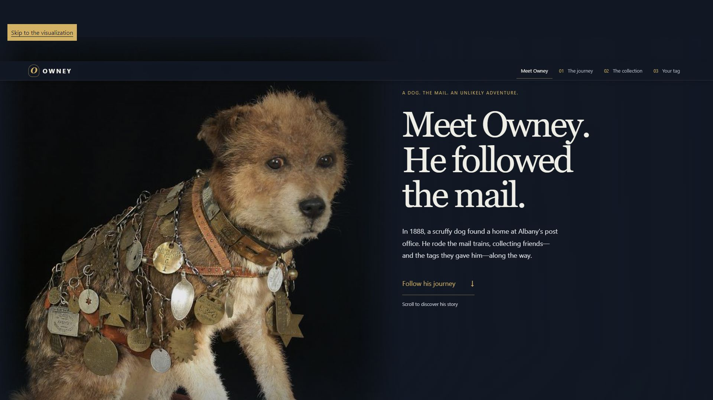
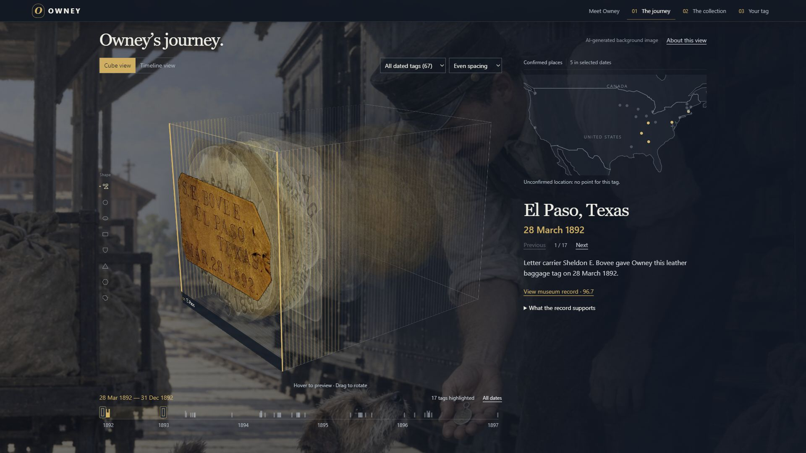
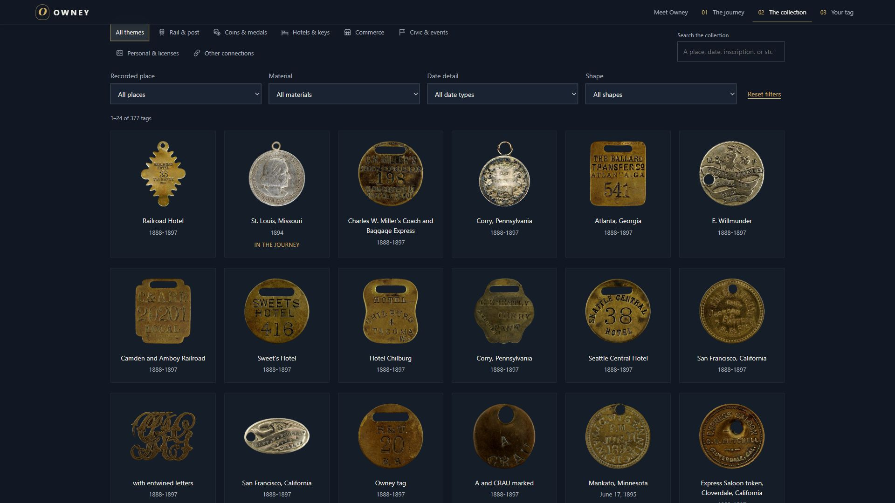

# Owney — A Life in Tags

**[Explore the live prototype](https://owney.icare.love/#intro)** · [Design rationale](docs/DESIGN.md) · [Data collection process](docs/process/Owney_data_collection_process.pdf)

Owney was a small dog who traveled with the mail in the late nineteenth century. Postal workers and admirers gave him tags as reminders of their encounters. This project explores how those small objects can tell a larger story about movement, friendship, and the traces a life leaves behind.

The project uses a Smithsonian Open Access snapshot retrieved on 22 September 2026. It contains 377 National Postal Museum tag records and 742 image entries. The Journey uses 67 tags with precise usable dates; its map includes only 23 tags across 21 cities where the museum description supports an encounter. Uncertain dates and places remain visible as gaps in the evidence rather than invented stops on a route.

The time cube treats each tag as an object in a chronological collection. Switching to Timeline view aligns the same layers with calendar time, making clusters and gaps easier to see. A linked map adds geographic context, while shape, theme, material, and date filters connect the Journey to the searchable collection. Viewers can inspect original museum records or return to all 377 objects at any time. A dedicated Rotate control enables touch rotation while preserving normal page scrolling outside that mode. Clicking a tag shifts its entire card, including photograph, frame, and label, by 50% of its width while preserving its chronological depth. The camera balances the projected cube and full card extension together, fitting the largest comfortable size with responsive margins. Framing follows rotation and stays stable when selecting another tag. The opening range highlights May–December 1896. An optional idle tour moves through the highlighted tags after 12 seconds without input, yielding immediately to interaction and respecting reduced motion.

The visual design combines dark blue, warm gold, large serif narrative headings, and quieter sans-serif controls. Transparent museum photographs give the tags room to stand out. Generated atmosphere images sit behind the evidence, and two painted running sequences imagine Owney as a living dog. After feedback, the map and cube were combined, controls became more compact, duplicated displays were removed, and the collection was linked to the Journey. [The design notes explain these choices and their limitations.](docs/DESIGN.md)

The concept, visual direction, and iterative design requests were developed by Haolong. Codex assisted with implementation, data preparation, documentation, and testing. OpenAI image generation produced the atmosphere illustrations and running-dog drawings; these are interpretations, not historical photographs or footage. Museum object images in this snapshot are CC0, and transparent cutouts preserve the original object pixels. Visitors' contemporary messages form a separate collection from the historical museum objects.

The running scenes prepare their artwork before motion begins and stop rendering when offscreen. The original sky above the distant hills drifts gently relative to the countryside, using a feathered copy of the existing sky pixels on a 20-second wind cycle. No additional foreground clouds are displayed. The optional soundtrack, [Broken Vow on YouTube](https://www.youtube.com/watch?v=CCSdRKSQXnE), opens only when the visitor clicks a subtle sound icon, available from the introduction onward. Its compact 200 × 200 official player starts at 12% volume and stays visible while playing. The small grip lets visitors drag it out of the way or tap it to move to another corner. Closing it pauses the music. No music file is included in this repository.

## Prototype screenshots

Three screenshots of the live prototype are included at 1920 × 1080 pixels (16:9). [Capture details](images/README.md).

## Sources and project documentation

[Smithsonian museum background](https://postalmuseum.si.edu/exhibition/about-postal-operations-popular-culture-seals-symbols/owney-the-dog) · [Open Access API](https://edan.si.edu/openaccess/apidocs/#api-search-search) · [Natural Earth map data](https://www.naturalearthdata.com/) · [Time-volume inspiration: Bradley Tangonan's xy + t](https://www.instagram.com/reel/DdaH9kpg4iA/)

[Running instructions and project guide](docs/PROJECT-GUIDE.md) · [Date evidence](DATED-TAGS.md) · [Map decisions](MAP-LOCATIONS.md) · [Shape classifications](TAG-SHAPES.md) · [Image processing](TOKEN-CUTOUTS.md) · [Animation process](docs/owney-whole-dog-animation.md) · [Submission provenance](docs/SUBMISSION.md) · [Assignment checklist](docs/ASSIGNMENT.md)

The included museum snapshot runs without a Smithsonian API key. The shared visitor-tag feature requires the included Worker/database backend; the linked live website provides the complete experience. Installed dependencies, generated build output, credentials, and live visitor data are excluded from this repository.
