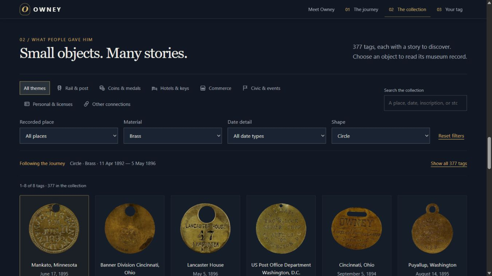

# Owney — A Life in Tags

An interactive data-visualization project about Owney, the postal dog, and the travel tags people gave him.

**[Open the live project](https://owney-through-time.hihaolong.chatgpt.site/?release=linked-collection-1#intro)**

The project brings together a chronological time cube, a map of confirmed encounters, a searchable museum collection, and a contemporary collection of visitor messages.



## Explore

- **Meet Owney:** a short introduction using a Smithsonian museum photograph.
- **The Journey:** 67 precisely dated tags, shown as transparent photographs in Cube view or Timeline view. Date highlighting and shape, theme, and material filters work together. The map only includes places supported by the museum descriptions.
- **The Collection:** all 377 tag records, with search, filters, source photographs, and museum links. It follows the Journey selection after interaction; “Show all 377 tags” restores the complete archive.
- **Your tag:** visitors can leave a place and message in the live shared collection and download a social-sharing image.

Two illustrated running sequences appear after the introduction and after the collection. They use complete drawings of the dog, not independently animated body parts.

## Data and process

The dataset is a Smithsonian Open Access search snapshot retrieved on **22 September 2026**. It is a study of this snapshot, not a complete reconstruction of Owney's travels.

| Snapshot measure | Count |
| --- | ---: |
| Records returned by the Owney search | 422 |
| Selected National Postal Museum tag records | 377 |
| Image entries in those tag records | 742 |
| Tags with a precise usable date | 67 |
| Dated tags with confirmed map locations | 23 |
| Distinct mapped cities | 21 |

Dates and descriptions come from museum records. Shape and theme groupings are project interpretations. City-center coordinates are added for display; no speculative routes are drawn. The dates and mapped subset are documented in the evidence files.

- [Data collection process — PDF](../docs/process/Owney_data_collection_process.pdf)
- [Data collection process — editable Word document](../docs/process/Owney_data_collection_process.docx)
- [Dated-tag evidence](../DATED-TAGS.md), [map decisions](../MAP-LOCATIONS.md), [shape classifications](../TAG-SHAPES.md), and [image processing](../TOKEN-CUTOUTS.md)
- [Current animation process and prompts](../docs/owney-whole-dog-animation.md)
- [Submission provenance and validation](../docs/SUBMISSION.md)

## Run the full application locally

Use a current Node.js installation and the pnpm version specified in `package.json`.

```sh
pnpm install --frozen-lockfile
pnpm build
node node_modules/wrangler/bin/wrangler.js d1 execute DB --local --file drizzle/0000_visitor_tags.sql
pnpm dev
```

Open **http://127.0.0.1:8766/**. The preview uses a local database, separate from the live site's visitor collection. The local Worker preview requires a platform supported by Cloudflare's runtime. If that runtime cannot start, the hosted project remains available for review.

```sh
node --test tests/catalog.test.mjs tests/community.test.mjs
```

The museum dataset is included. A Smithsonian API key is **not** required to build or run this snapshot. No API keys or live visitor database are included in the submission.

GitHub stores this source submission. GitHub Pages alone does not run the Worker/database features; use the live link to review the full shared visitor experience.

## Project structure

| Path | Purpose |
| --- | --- |
| `public/` | HTML, CSS, browser JavaScript, prepared data, photographs, and current animation assets |
| `source-data.json` | Raw museum records for the 377 selected objects |
| `catalog-source.json` | Normalized catalog fields |
| `*-evidence.json` | Date, place, and shape decisions with source references |
| `prepare-data.cjs` | Rebuilds the browser dataset from the included sources and audits |
| `worker/`, `db/`, `drizzle/` | Visitor-tag server, schema, and migrations |
| `scripts/`, `tests/` | Build/preview support and checks |
| `docs/` | Process documents, screenshots, prompts, and implementation notes |

Installed dependencies, generated build output, local database state, credentials, and obsolete animation renderers are excluded. The `.openai/hosting.json` file is retained because the existing build reads it; its project identifier is not an access credential. Cloning this repository does not publish to or grant access to the live site.

## Sources, credits, and AI assistance

- [Smithsonian National Postal Museum: Owney](https://postalmuseum.si.edu/exhibition/about-postal-operations-popular-culture-seals-symbols/owney-the-dog)
- [Smithsonian Open Access API](https://edan.si.edu/openaccess/apidocs/#api-search-search)
- [Natural Earth](https://www.naturalearthdata.com/) map boundaries via [World Atlas](https://github.com/topojson/world-atlas). Modern borders provide context, not historical border reconstruction.
- Time-volume inspiration: [Bradley Tangonan's xy + t](https://www.instagram.com/reel/DdaH9kpg4iA/).

Museum object photographs in this snapshot are marked CC0; individual source links are preserved. Transparent tag cutouts were made through ordinary image processing that preserves the original object pixels. Unedited photographs remain available in each object's detail view.

The project concept, visual direction, and iterative design requests were developed by Haolong. Codex assisted with implementation, data preparation, documentation, and testing. OpenAI image generation produced the atmosphere illustrations and painted running-dog drawings. These illustrations are interpretations, **not historical photographs or footage**. Generated image prompts are included in this repository. No blanket license is assigned to all project materials by this submission.
